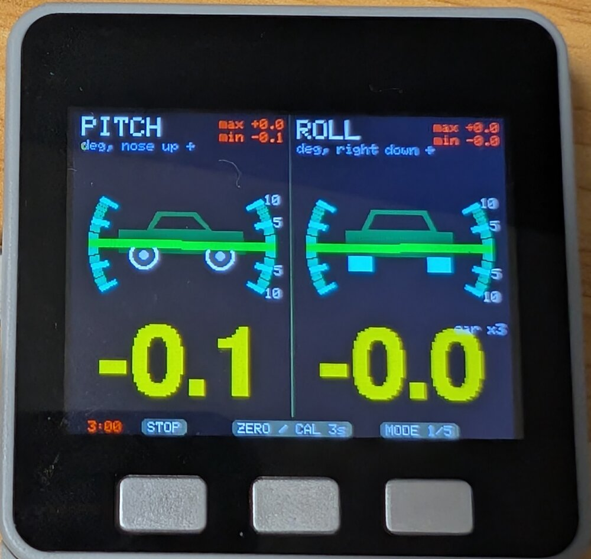
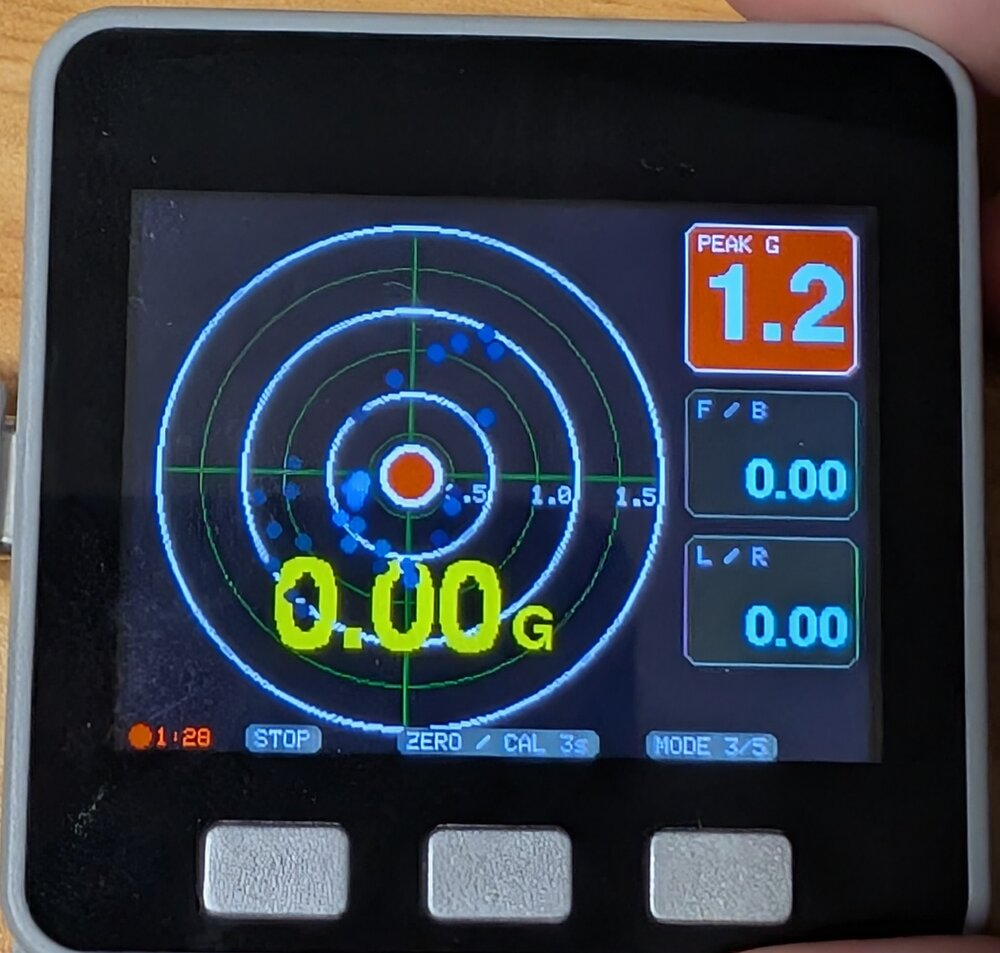
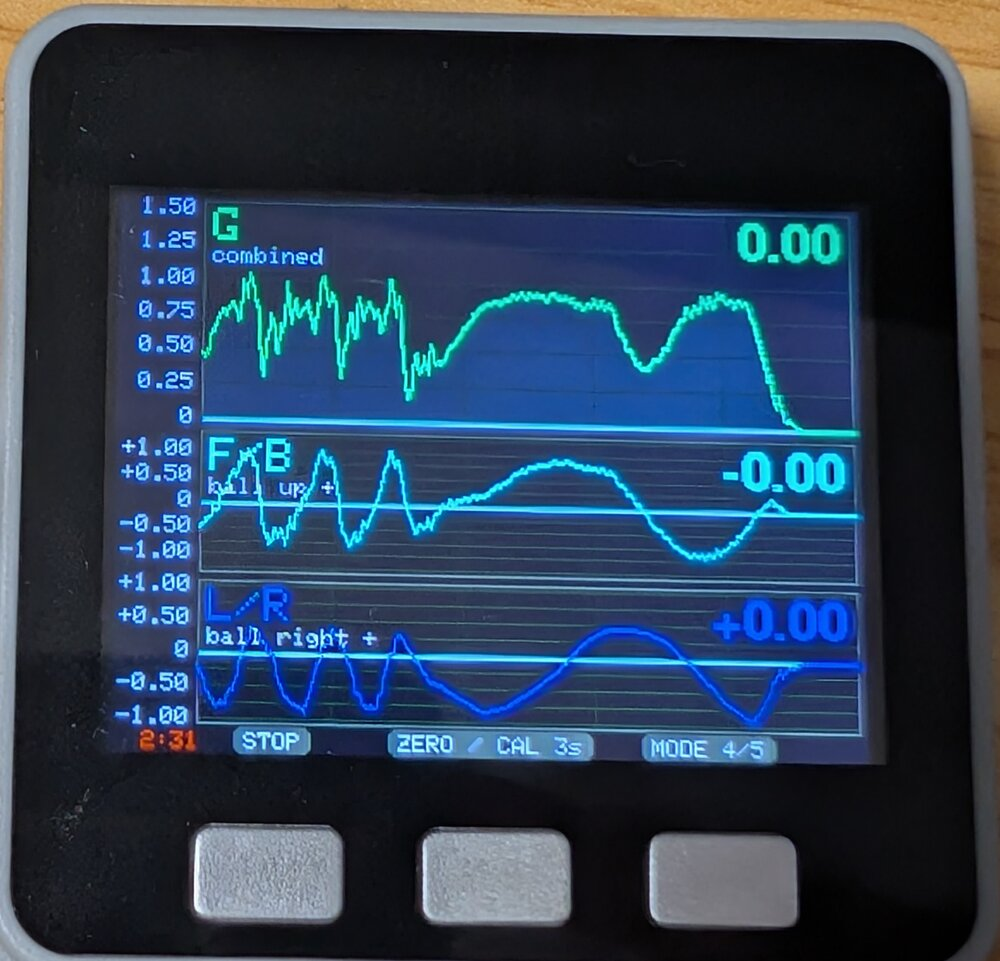
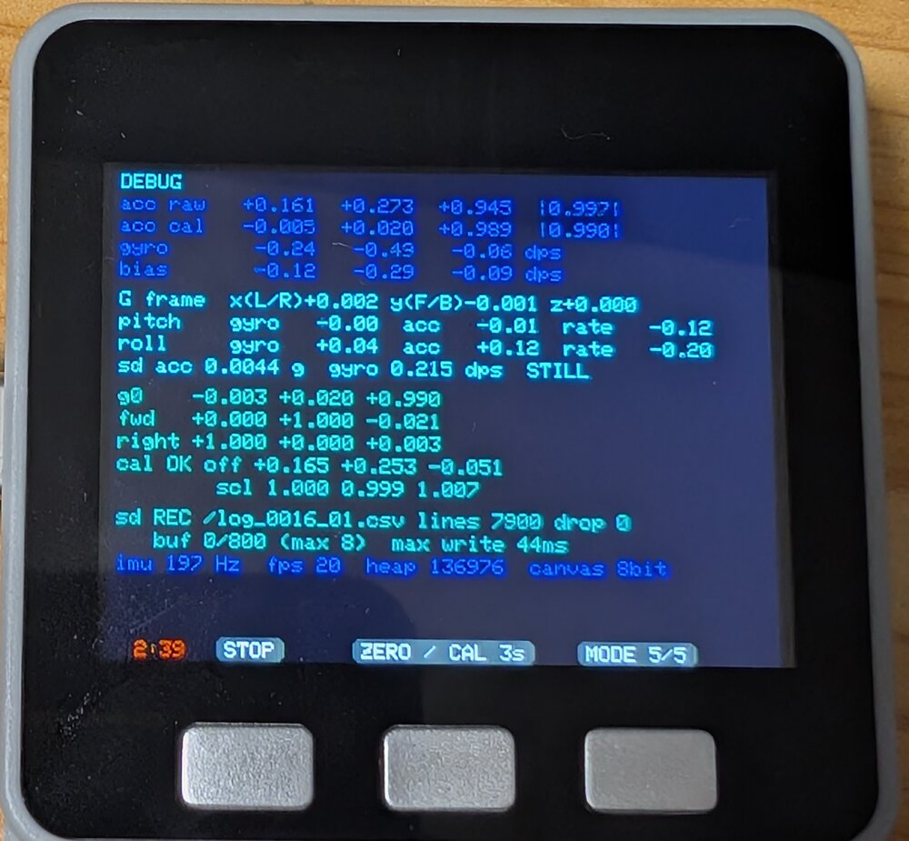
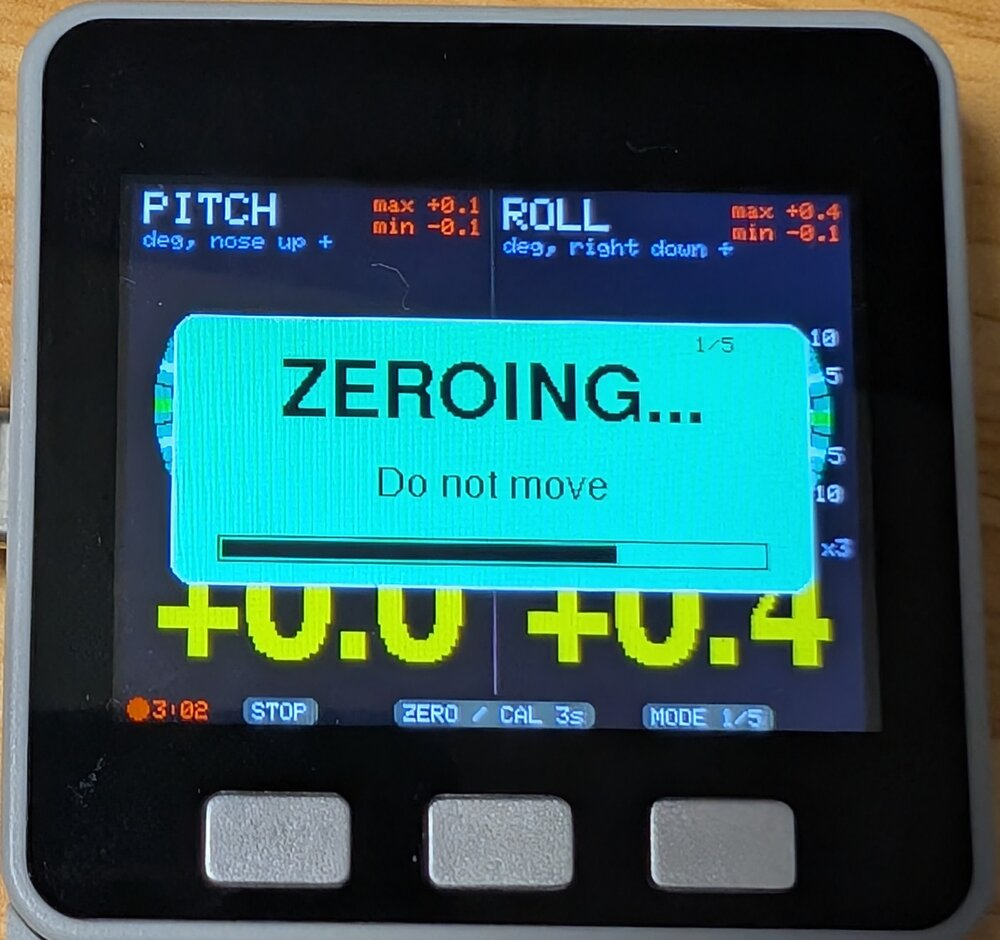
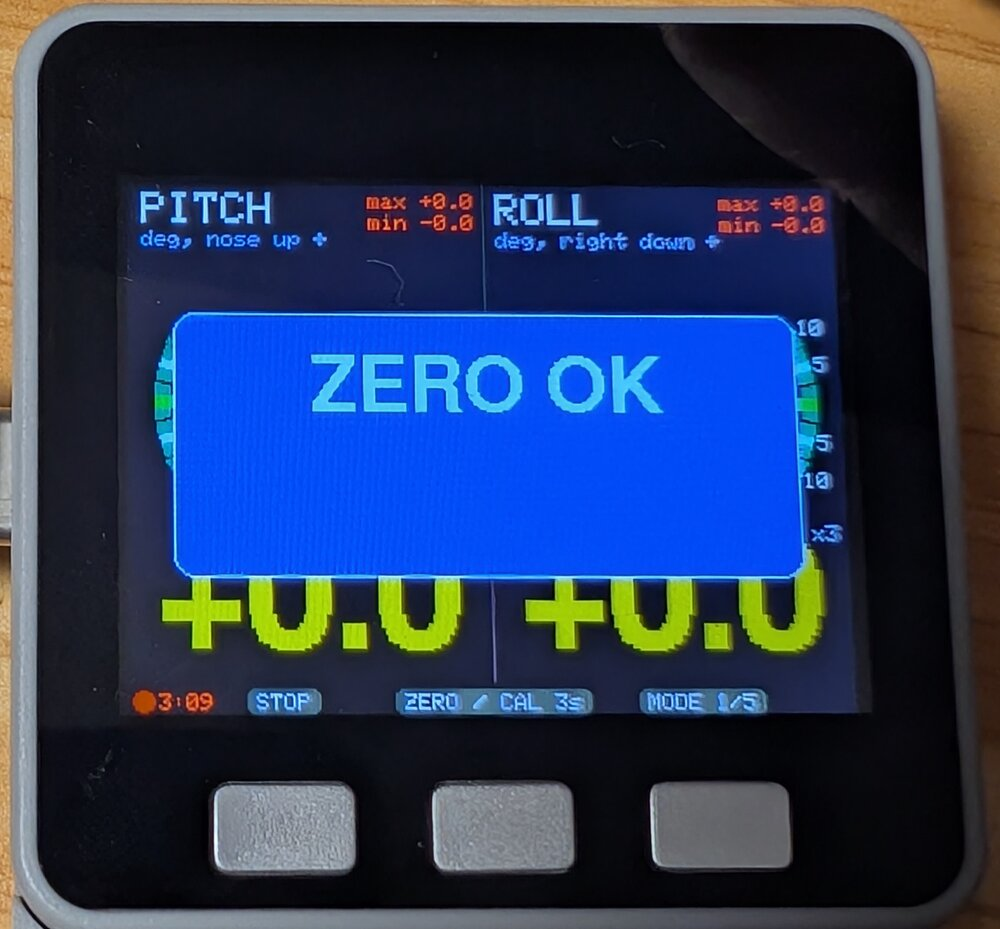
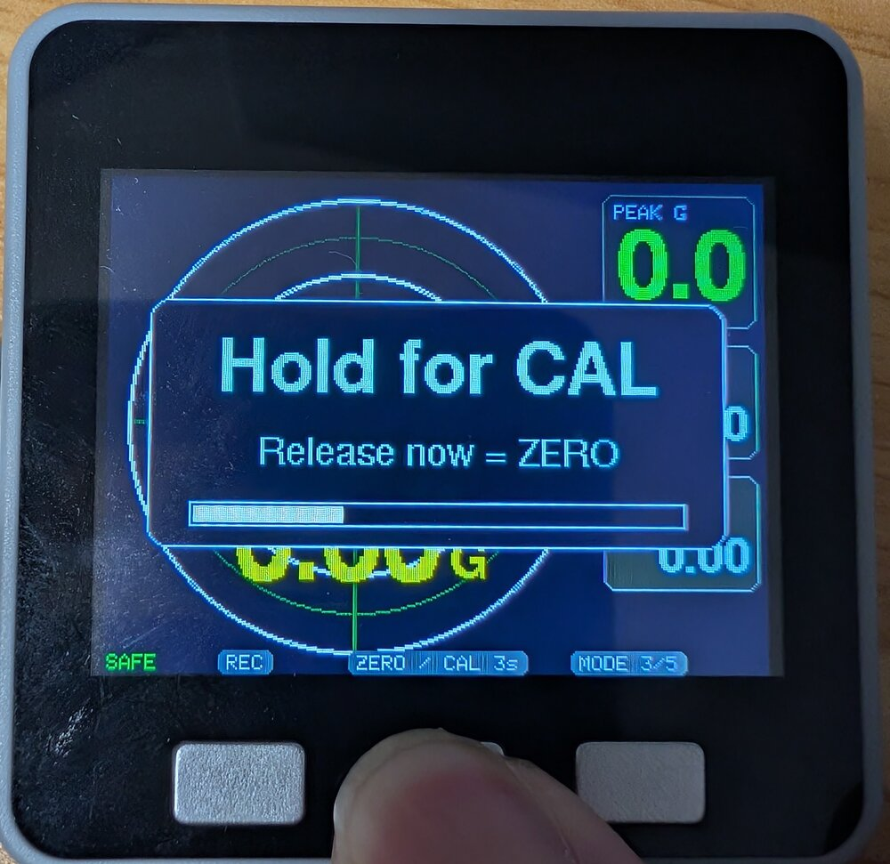
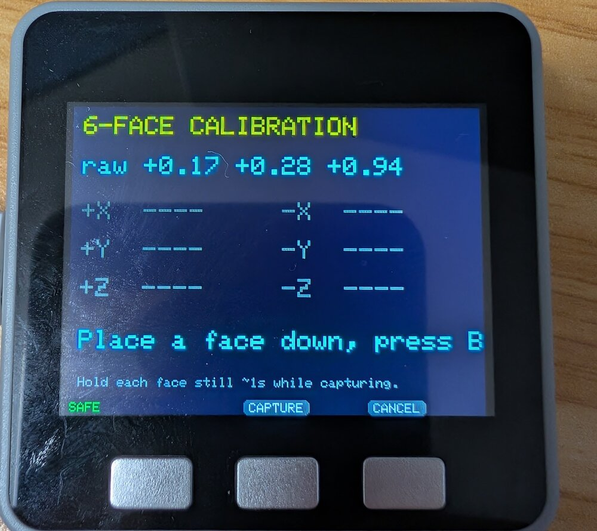
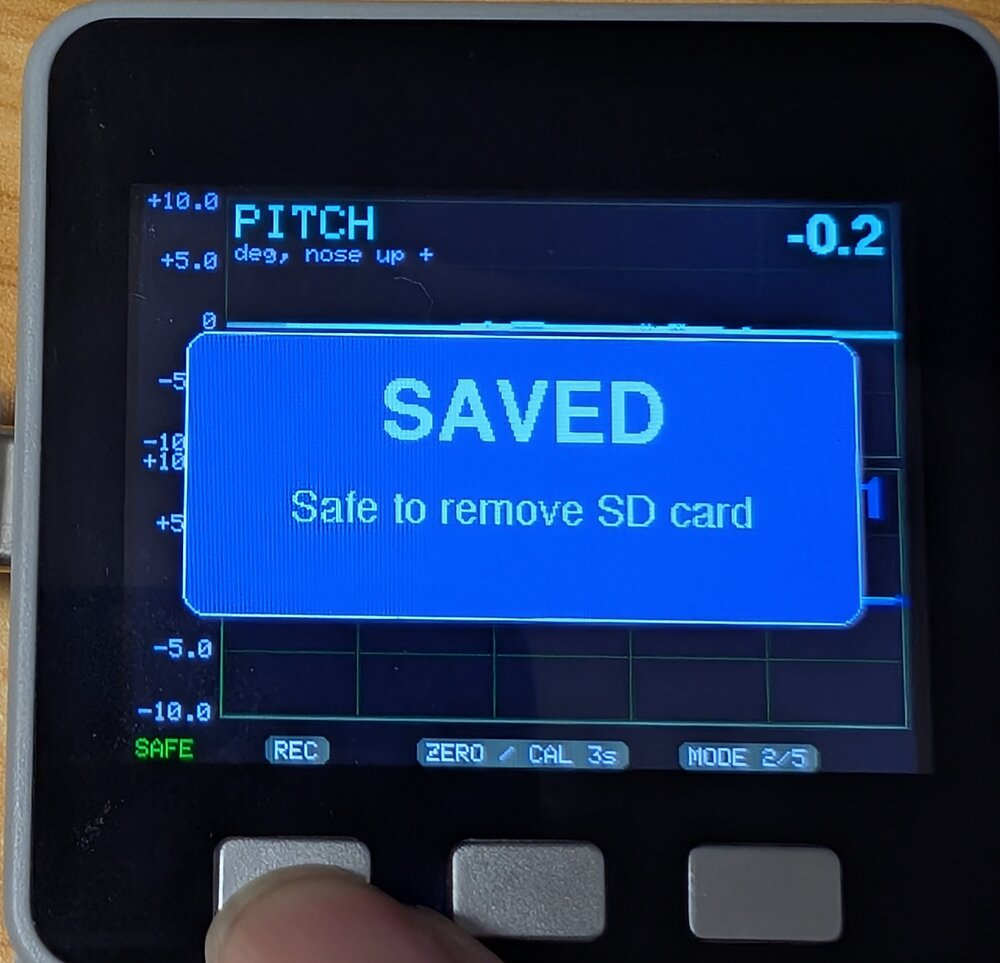

# G メーター / 姿勢メーター（M5Stack）

M5Stack の IMU を使った車載向けメーターです。
加速度（G）・車体のピッチ / ロールをリアルタイムに表示し、SD カードに 50Hz で記録します。

 

## ハードウェア

動作確認は **M5Stack Gray**（ESP32, 4MB Flash, IMU: MPU9250）で行っています。

| 項目 | 要件 |
|---|---|
| 本体 | IMU を搭載した M5Stack（320x240 画面, A/B/C ボタン）。**M5Stack Basic は IMU がないため動作しません** |
| IMU | M5Unified が対応する IMU（MPU9250 / MPU6886 / BMI270 など）。地磁気センサーは未使用 |
| SD カード | microSD。**FAT32 必須**（exFAT は不可）。なくても記録以外は動作します |

## 画面

C ボタン（右）で 1 → 5 の順に切り替わります。起動時は姿勢メーターです。
画面最下段には、各ボタンの真上にその役割（`STOP` / `ZERO / CAL 3s` / `MODE n/5`）が表示されます。左下は記録状態（赤丸と経過時間＝記録中、`SAFE`＝SD を抜いてよい）です。

### 1. 姿勢メーター


- 左がピッチ（横から見た車、前が右）、右がロール（後ろから見た車）。
- 目盛りは ±10°（1° ごと）。車のイラストと赤い針は見やすいよう **3 倍に強調**して傾けます（`car x3`）。
- 大きな黄色の数字が現在の角度（度）、右上の赤字が最小 / 最大です。
- 静止と判定されている間は左下に `STILL` が出ます（この間に角度の誤差を補正します）。

### 2. ピッチ・ロール推移

ピッチ（上）とロール（下）の直近 10 秒のグラフです。縦軸は ±10° で、超えると自動で広がります。

### 3. G メーター


- 外周 1.5G の円（白い円が 0.5G ごと）に、現在の G をボール、直近の動きを青い軌跡で表示します。
- 円内の大きな数字が水平方向の合成 G です。**1G を超えると赤背景・白文字**になります（1G 以下に戻ってから 0.2 秒保持）。
- 右側は PEAK G（小数点 1 桁）、前後（F / B）、左右（L / R）。三角は向きを示します。
- PEAK G は **1G を超えるとカードが赤**になります。最後に更新されてから **20 秒**で現在値にリセットされます。

### 4. G 推移



上から合成 G（0〜1.5G）、F/B、L/R の直近 10 秒のグラフです。時間軸がそろっているので、ブレーキで F/B が出たときの合成 G の動きを縦に見比べられます。

### 5. デバッグ



加速度・ジャイロの生値と補正値、ジャイロバイアス、ジャイロと加速度それぞれから求めた角度、静止判定、基準面の軸、キャリブレーション値、SD の状態（ファイル名・行数・取りこぼし数・書き込み時間）、IMU 周波数、FPS、空きメモリを表示します。

### 符号の向き

| 値 | 正の向き |
|---|---|
| pitch | ノーズアップ |
| roll | 右側が下がる |
| F/B（g_fb） | G メーターのボールが上へ動く向き |
| L/R（g_lr） | G メーターのボールが右へ動く向き |

## 操作

### 本体ボタン

| ボタン | 通常画面 | キャリブレーション画面 |
|---|---|---|
| A（左） | 記録の開始 / 停止（REC / STOP） | — |
| B（中） | 短押し（離したとき）: ゼロ点 / **3 秒長押し**: 6 面キャリブレーション | 現在の面を測定（CAPTURE） |
| C（右） | モード切替 | 中止（CANCEL） |

### シリアルコマンド（動作確認用）

シリアル（115200bps）から 1 文字送ると、ボタンと同じ操作ができます。

| 文字 | 操作 |
|---|---|
| ` `（スペース） | ゼロ点（キャリブレーション中は測定） |
| `c` | 6 面キャリブレーション開始（キャリブレーション中は中止） |
| `m` | モード切替 |
| `l` | 記録の開始 / 停止 |
| `r` | PEAK G・ピッチ / ロールの最小最大をリセット（ボタンには割り当てなし） |

## ゼロ点とキャリブレーション

この 2 つは役割が違います。

| | 6 面キャリブレーション | ゼロ点 |
|---|---|---|
| 目的 | センサー各軸のオフセット・スケール誤差の補正 | 取り付け姿勢を基準面にする |
| 頻度 | 最初に 1 回（フラッシュに保存） | 取り付け場所や向きを変えたとき |
| 操作 | B 長押し 3 秒 → 6 面を順に下にして静止 → B | B 短押し（**停車中に**） |

 

- **ゼロ点**: 0.7 秒待ってから 0.5 秒間平均し、重力方向を鉛直、本体 X 軸（画面の左右）を水平面に投影した向きを「右」とします。平置き・縦置きのどちらでも使えます。揺れていると最大 5 回測り直し、収まらなければ「ZERO FAILED」で前回の値を維持します。起動時にも自動で行います。

 

- **6 面キャリブレーション**: B を押し続けると「Hold for CAL」とバーが出て、3 秒で開始します（途中で離すとゼロ点）。各面で約 1 秒静止させて測ります。面の判定は自動なので順番は自由です。6 面そろうと補正値を計算して保存し、ゼロ点を取り直します。温度でずれるので、合成 G が 1 から大きく外れるようならやり直してください。

## 姿勢推定の仕組み

- 「上」方向のベクトルをジャイロで回転させ（200Hz）、そこからピッチ・ロールを求めます。
- ブレーキ中は加速度が傾きと区別できない（0.5G で約 27° 相当）ため、加速度による補正は次のときだけかけます。
  - **静止中**（加速度・ジャイロのばらつきが小さい状態が 1 秒続く。画面に `STILL`）: 時定数 0.5 秒で補正し、ジャイロバイアスにも追従
  - **走行中**: 加速度とジャイロの向きの差が 3° 未満のときだけ、時定数 5 秒でゆっくり補正
- 測っているのは車体の重力に対する傾きなので、道路の勾配変化も含まれます。

## SD カード記録

- 起動時にカードがあれば自動で記録を開始します。
- ファイル名: `/log_{セッション番号4桁}_{記録番号2桁}.csv`
  - セッション番号: SD カードありで起動するたびに +1（フラッシュに保存）
  - 記録番号: 同じセッション内で REC を押し直すたびに +1
- 50Hz、約 17MB / 時間。1 秒ごとに flush します。
- 200Hz のサンプルを 4 個ずつ平均して記録します（単純な間引きだと 25Hz 超の振動が偽の遅い揺れとして記録されるため）。5Hz 以下の車体の動きは 98% 以上そのまま残ります。
- 頻度は `src/main.cpp` の `LOG_DECIM`（200Hz を何個ずつ平均するか）で変えられます。

### 記録の停止と SD カードの取り外し



A（STOP）を押すと「SAVING...」→ ファイルを閉じてアンマウント →「SAVED / Safe to remove SD card」と表示され、左下が緑の `SAFE` になります。**`SAFE` の状態なら抜いて構いません。**
再度 A を押すとマウントし直して記録を再開します（カードの差し替えも可）。

> 記録中に電源が切れると、最後の約 1 秒分のデータを失い、まれにファイルシステムが壊れる可能性があります。電源を切る前に A で停止してください。

### CSV の列

ファイル先頭の `#` 行にセッション番号・キャリブレーション値・符号の向きを記録しています。

| 列 | 内容 |
|---|---|
| `t_ms` | 記録開始からの時間（ms, 平均した区間の中央） |
| `pitch_deg`, `roll_deg` | ピッチ / ロール（度） |
| `g_fb`, `g_lr`, `g_ud` | 基準面上の動的加速度（G, 重力を除去）。前後 / 左右 / 上下 |
| `g_comb` | 水平方向の合成 G |
| `gyro_x/y/z` | バイアス補正後の角速度（deg/s, 本体座標） |
| `acc_x/y/z` | キャリブレーション補正後の加速度（G, 本体座標） |
| `still` | 静止判定（1 = 静止） |
| `zero_id` | ゼロ点を取り直すたびに増える番号（区間の区別用） |

## ビルドと書き込み

[PlatformIO](https://platformio.org/) プロジェクトです。

### セットアップ（Linux）

必要なツール（uv, PlatformIO Core）とバージョンは `mise.toml` に定義しています。[mise](https://mise.jdx.dev/) でまとめてインストールします（PlatformIO は uv 経由で入り、Python も uv が用意します）。

```sh
curl https://mise.run | sh            # mise をインストール（入っていなければ）
mise trust && mise install            # このディレクトリで実行。uv と PlatformIO をインストール
sudo usermod -aG dialout $USER        # シリアルポートの権限。反映には再ログインが必要
```

M5Stack を USB で接続すると `/dev/ttyUSB0` などとして認識されます（USB シリアル変換チップのドライバは Linux 標準で入っています）。

### ビルド・書き込み

このディレクトリで `mise run <タスク>` を実行します。初回はツールチェーンとライブラリが自動でダウンロードされます。

| コマンド | 内容 |
|---|---|
| `mise run build` | ビルド |
| `mise run upload` | ビルドして書き込み |
| `mise run monitor` | シリアルモニタ（115200bps） |
| `mise run dev` | 書き込んでからシリアルモニタを開く |
| `mise run clean` | ビルド成果物を削除 |

ポートは自動検出されます。指定する場合は `PORT=/dev/ttyUSB0 mise run upload` のように渡します。

- ライブラリ: `m5stack/M5Unified`（`platformio.ini` の `lib_deps` で自動取得）
- 初回起動後、B ボタン長押しで 6 面キャリブレーションを行ってください（「ゼロ点とキャリブレーション」参照）

## Gray 以外で使う場合

- `platformio.ini` の `board = m5stack-grey` を機種に合わせて変更してください（例: Fire は `m5stack-fire`, Core2 は `m5stack-core2`）。
- SD のピンは Basic / Gray / Fire 用（CS=4, SCK=18, MISO=19, MOSI=23）に固定しています（`src/main.cpp` の `mountSd()`）。Core2・CoreS3 などピンが異なる機種では変更が必要です。

## ソフトウェア構成

| タスク | コア | 優先度 | 役割 |
|---|---|---|---|
| IMU タスク | 0 | 3 | IMU を 200Hz で読み、姿勢推定・G 計算・履歴・ログ用リングバッファへの書き込み |
| SD タスク | 0 | 1 | リングバッファ（16 秒分）から取り出して CSV で SD へ書く |
| loop | 1 | — | ボタン処理と画面描画（約 25fps） |

- I2C（IMU）は IMU タスクだけが触ります。
- SD と液晶は SPI を共有しているため、SD アクセスと画面転送は `spiMutex` で排他しています。
- 描画は 320x240 / 8bit のスプライトに描いてから転送します（16bit は連続メモリが足りないため）。
