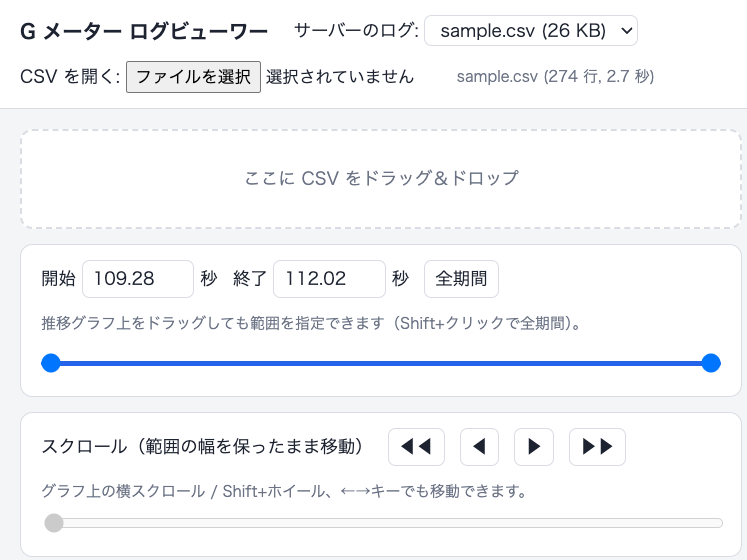
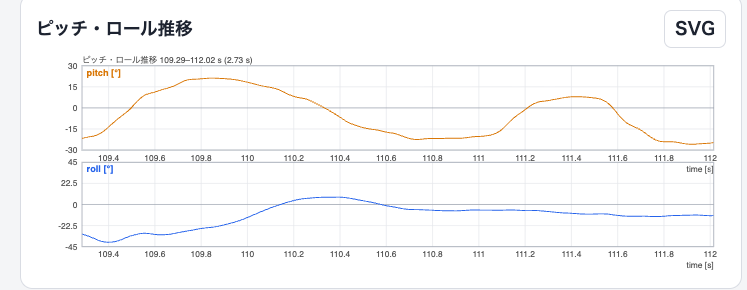
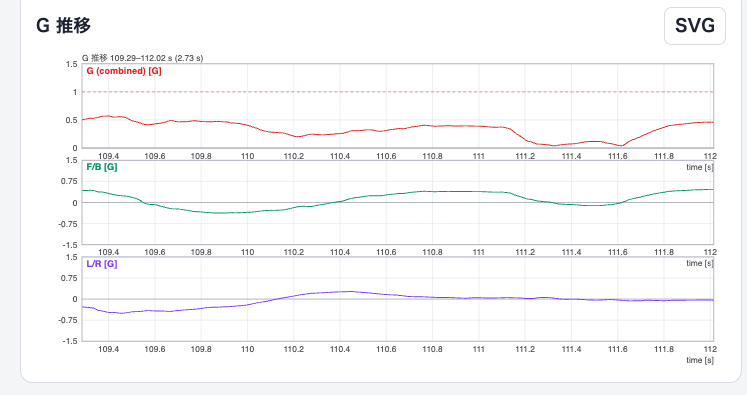
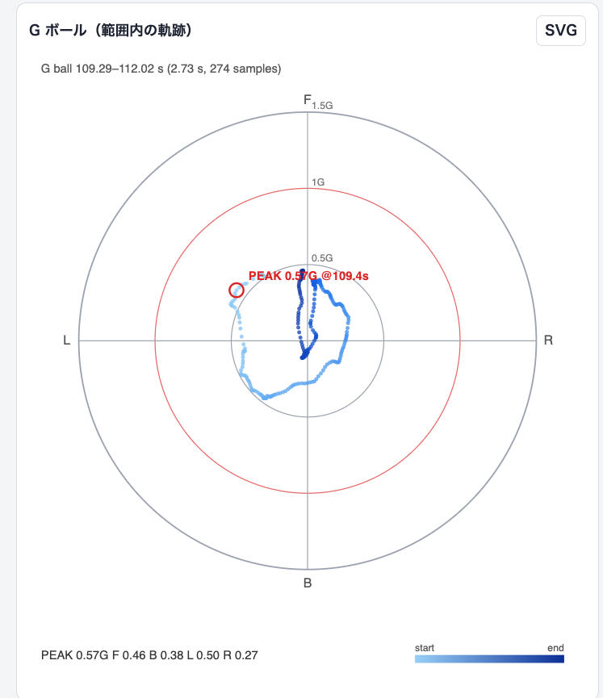

# G メーター ログビューワー

SD カードに記録した CSV（[親 README](../README.md) 参照）を読み込み、アプリと同様のグラフと、範囲内の G ボールをブラウザに描画します。Node.js のみで動き、依存パッケージはありません。

## 起動

```sh
cd viewer
mise run start          # node を mise で入れる場合
# または
node server.js          # ログ置き場は logs/、ポートは 3000
```

http://localhost:3000/ を開きます。ログのディレクトリやポートは `LOG_DIR=... PORT=... mise run start`、または `node server.js <ディレクトリ> <ポート>` で変えられます。

## 使い方

### CSV を開く・範囲を決める



- CSV は、ドラッグ＆ドロップ、「ファイルを選択」、または `logs/` に置いたものをプルダウンから選んで開きます（`logs/sample.csv` はサンプル）。
- **開始 / 終了**（秒）の入力、二重スライダー、推移グラフ上のドラッグのどれでも描画範囲を指定できます。「全期間」または Shift+クリックで戻ります。
- **スクロール**で、範囲の幅を保ったまま移動できます（◀▶ ボタン、スライダー、グラフ上の横スクロール / Shift+ホイール、←→ キー）。
- 範囲の統計値（PEAK G、ピッチ・ロールの min / max など）も一緒に切り替わります。

### ピッチ・ロール推移



ピッチ（上）とロール（下）の推移です。縦軸は ±10° から始まり、超えると自動で広がります。

### G 推移



合成 G（0〜1.5G、赤点線が 1G）、F/B、L/R の推移です。時間軸は上のグラフとそろっています。

### G ボール



選んだ範囲の G の軌跡です（古い点は薄く、新しい点ほど濃い青）。円は 0.5G ごとで、赤い円が 1G です。赤丸が PEAK G で、下に PEAK と F / B / L / R それぞれの最大値を出します。

### SVG の保存

各グラフの **SVG** ボタンで、いま表示している範囲のグラフを SVG としてダウンロードできます（例: `sample_ball_109.28-112.02s.svg`）。

## 補足

- `t_ms` が 1 秒以上飛んでいる区間は、線をつながずに途切れさせます。
- データが多いときは、グラフの画素ごとに最小・最大だけを残して間引くため、ピークは落ちません。G ボールの点は最大 3000 点に間引きますが、PEAK は全点から探します。
